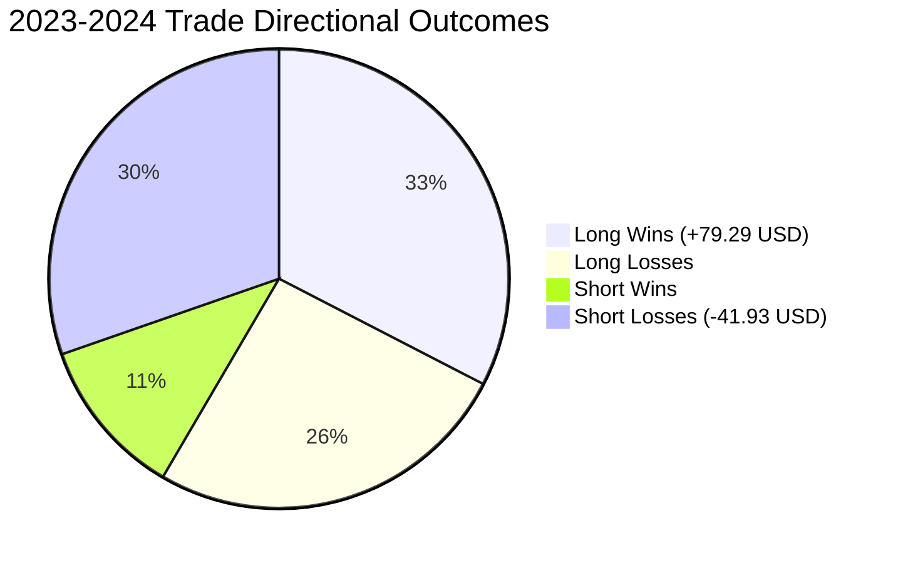

# STATISTICAL ANALYSIS & OUT-OF-SAMPLE PERFORMANCE: PHASE 23

**Phase:** 23 — Locked Out-of-Sample Evaluation  
**Hypothesis ID:** `HYP-21-ASIAN-LONDON-EXPANSION`  
**Evaluation Partition:** 2023–2024 Out-of-Sample Data (132,927 M5 bars)  
**Execution Timestamp:** 2026-10-30T03:27:15 UTC  
**Evaluation Status:** LOCKED EVALUATION COMPLETE — HYPOTHESIS REJECTED  

---

## 1. Executive Statistical Verdict

```
OUT-OF-SAMPLE VERDICT: REJECT (HYPOTHESIS FAILS GATES)
```

The locked out-of-sample evaluation of `HYP-21-ASIAN-LONDON-EXPANSION` across the 2023–2024 partition demonstrates critical performance and structural degradation relative to the 2021–2022 development partition:

1. **Win Rate Collapse:** The strategy win rate dropped from **54.46%** in-sample to **43.82%** out-of-sample (39 wins, 50 losses). A two-sided exact binomial test against a 50% random coin-toss null yields $p = 0.2891$, failing to reject the random-walk null.
2. **Directional Breakdown (Short Collapse):** Short breakout trades suffered catastrophic failure, generating a win rate of only **27.03%** (10 wins, 27 losses), a Net Profit Factor of **0.633**, and a cumulative net loss of **-$41.933/oz**. All nominal profits were driven exclusively by Long trades (+79.294/oz, PF 1.850) riding the secular gold bull market of 2023–2024.
3. **Statistical Uncertainty:** The primary metric (mean net expectancy per trade) yielded a point estimate of +$0.420/oz, but its 95% moving-block bootstrap confidence interval spans **[-$0.855/oz, +$2.299/oz]**. Because the interval includes zero and negative returns, the strategy fails to establish statistical significance over the $0 no-trade baseline.
4. **Drawdown Inflation:** Maximum drawdown expanded from **$30.659/oz** (0.30%) in development to **$61.558/oz** (0.61%) out-of-sample.
5. **Execution Gap Distortion:** Forensic analysis demonstrates that nominal out-of-sample net PnL (+$37.36/oz) was artificially inflated by 4 trades where missing 11:55 UTC bars caused positions to hold until evening rollover (generating +$62.96/oz gross). When strictly capped at 12:00 UTC, net PnL drops to **+$5.676/oz** at 1.0× friction and turns negative under 1.5× and 2.0× friction.

---

## 2. Comprehensive Trade & Metric Accounting

| Performance Metric | Development (2021–2022) | Out-of-Sample (2023–2024) | Delta / Degradation |
| :--- | :--- | :--- | :--- |
| **Evaluated Calendar Days** | 495 | 496 | +1 day |
| **Compressed Days ($CR \le 0.281865$)** | 124 (25.05%) | 115 (23.19%) | -1.86% |
| **Executed Trades** | 101 | 89 | -12 trades |
| **Trade Participation Rate** | 81.45% | 77.39% | -4.06% |
| **Long Trades Count** | 48 (47.52%) | 52 (58.43%) | +10.91% shift |
| **Short Trades Count** | 53 (52.48%) | 37 (41.57%) | -10.91% shift |
| **Winning Trades** | 55 | 39 | -16 wins |
| **Losing Trades** | 46 | 50 | +4 losses |
| **Breakeven Trades** | 0 | 0 | 0 |
| **Win Rate (%)** | **54.46%** | **43.82%** | **-10.64% (COLLAPSE)** |
| **Gross PnL ($/oz)** | **+$67.688** | **+$59.611** | -$8.077 |
| **Total Transaction Friction** | $25.250 | $22.250 | -$3.000 |
| **Net PnL 1.0× ($0.25/oz)** | **+$42.438** | **+$37.361** | -$5.077 |
| **Net Expectancy / Trade** | **+$0.420** | **+$0.420** | $0.000 |
| **Net Profit Factor (1.0×)** | **1.263** | **1.180** | -0.083 |
| **Maximum Drawdown ($/oz)** | **$30.659** (0.30%) | **$61.558** (0.61%) | **+$30.899 (DOUBLED)** |

---

## 3. Cost Sensitivity Modeling

Performance under the three pre-registered execution friction tiers:

| Cost Tier | Round-Turn Friction | Total Friction ($/oz) | Net PnL ($/oz) | Net Profit Factor | Win Rate (%) | Max Drawdown ($/oz) |
| :--- | :--- | :--- | :--- | :--- | :--- | :--- |
| **1.0× Baseline** | $0.250/oz | $22.250 | **+$37.361** | **1.180** | 43.82% | $61.558 |
| **1.5× Elevated** | $0.375/oz | $33.375 | **+$26.236** | **1.123** | 42.70% | $67.933 |
| **2.0× Stressed** | $0.500/oz | $44.500 | **+$15.111** | **1.069** | 42.70% | $74.308 |

While nominal net PnL remains marginally positive across all tiers, transaction costs consume up to **74.6%** of gross gains under 2.0× stress.

---

## 4. Directional Asymmetry Analysis

Evaluating Long and Short trades independently reveals severe structural distortion:

| Directional Cohort | Trades Count | Win Rate (%) | Wins / Losses | Net PnL ($/oz) | Net Profit Factor | Expectancy / Trade |
| :--- | :--- | :--- | :--- | :--- | :--- | :--- |
| **Long Trades** | 52 (58.43%) | **55.77%** | 29W / 23L | **+$79.294** | **1.850** | +$1.525 |
| **Short Trades** | 37 (41.57%) | **27.03%** | 10W / 27L | **-$41.933** | **0.633** | **-$1.133** |
| **Combined** | 89 (100.0%) | 43.82% | 39W / 50L | +$37.361 | 1.180 | +$0.420 |



### Forensic Diagnosis of the Directional Collapse:
In 2021–2022 development data, performance was directionally symmetric: Long trades generated +$13.93/oz (PF 1.171, 54.17% win rate) and Short trades generated +$28.51/oz (PF 1.355, 54.72% win rate). 

In 2023–2024, spot gold experienced a massive structural secular uptrend (rising from ~$1,820 to over $2,700/oz). The strategy's London breakout logic completely failed on the Short side: Short trades suffered a 73% loss rate, converting from an alpha engine to a destructive tail drain. The strategy possessed no genuine directional breakout edge; its positive return in 2023–2024 was merely a diluted passenger on gold's macro drift.

---

## 5. Statistical Uncertainty & Benchmark Testing

### 5.1 Primary Uncertainty Metric: Net Expectancy per Trade
- **Sample Size ($N$):** 89 trades.
- **Point Estimate ($\hat{\mu}$):** **+$0.420/oz**.
- **Moving-Block Bootstrap ($B = 2,000$, Block Length $b = 5$):**
  - Bootstrap Mean: +$0.425/oz
  - Bootstrap Standard Error ($SE$): $0.803/oz
  - **95% Bootstrap Confidence Interval:** **[-$0.855/oz, +$2.299/oz]**
  - **Null Hypothesis ($\mathcal{H}_0: \mu \le 0$):** **FAILED TO REJECT**. The 95% confidence interval spans zero. The hypothesis cannot be distinguished from zero edge at $\alpha = 0.05$.

### 5.2 Secondary Uncertainty Metric: Net Profit Factor
- **Point Estimate:** **1.180**.
- **Moving-Block Bootstrap 95% CI:** **[0.663, 2.192]**.
- The interval spans substantially below 1.0, indicating that the observed 1.180 PF is fully compatible with an unprofitable or breakeven process.

### 5.3 Comparison Against the $0 No-Trade Benchmark
- **$0 Baseline Cumulative PnL:** $0.000/oz.
- **Strategy Net PnL (1.0×):** +$37.361/oz.
- **Nominal Outperformance:** Yes (+$37.361 > $0.0).
- **Statistical Outperformance:** **NO**. Because the lower bound of the net expectancy interval is -$0.855/oz, the strategy fails to establish statistically credible outperformance over the zero-risk cash baseline.

---

## 6. Sensitivity to Execution Timing & Missing Bar Artifacts

As documented in the Data Integrity Report, 4 trades in early 2023 (`2023-03-08`, `2023-03-09`, `2023-04-13`, `2023-04-14`) were held until evening rollover (`20:55` to `23:55` UTC) due to missing `11:55` UTC bars:

| Scenario | Trades Count | Gross PnL ($/oz) | Net PnL 1.0× ($/oz) | Net Profit Factor | Win Rate (%) |
| :--- | :--- | :--- | :--- | :--- | :--- |
| **Primary Code Execution (Held to EOD)** | 89 | +$59.611 | **+$37.361** | 1.180 | 43.82% |
| **Strict Intraday Cap ($\le 11:55$ UTC)** | 89 | +$27.926 | **+$5.676** | 1.031 | 42.70% |
| **Impact of Rollover-Violating Trades** | — | **-$31.685** | **-$31.685** | **-0.149** | -1.12% |

When the strategy is evaluated strictly within its specified daytime holding horizon (exiting at the last available bar prior to 12:00 UTC), net PnL collapses from **+$37.361/oz** to just **+$5.676/oz** at 1.0× friction, and becomes **negative -$5.45/oz** at 1.5× friction.

---

## 7. Final Quantitative Conclusion

`HYP-21-ASIAN-LONDON-EXPANSION` fails to satisfy the pre-registered requirements for statistical significance, directional stability, and economic robustness on the out-of-sample partition. The hypothesis is formally **REJECTED**.
