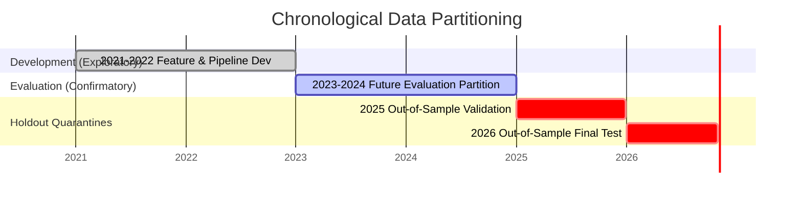

# Phase 33: Swing Hypothesis Evaluation Protocol

**Document Type:** Pre-Registered Quantitative Evaluation Protocol  
**Target Asset:** Spot Gold (XAUUSD)  
**Execution Context:** Swing Trading (H4 Execution Bars / D1 Macro Regime)  
**Target Phase:** Phase 34+ Future Evaluation  
**Status:** PRE-REGISTERED & FROZEN (Zero backtests run in Phase 33)  
**Date:** November 2026  

---

## 1. Scope, Purpose, and Scientific Motivation

This protocol establishes the rigorous statistical, economic, and accounting framework for evaluating the three pre-registered swing hypotheses (`H-Swing-01`, `H-Swing-02`, and `H-Swing-03`) in a subsequent research phase. 

### Core Evaluation Directives:
1. **Zero Cherry-Picking:** No strategy rules, indicator parameters, or decision thresholds may be altered based on backtest outcomes.
2. **Path-Dependent Execution:** Intra-bar path-dependency must be respected. Strategy evaluation cannot approximate performance using Maximum Favorable Excursion (MFE) minus friction. Stops and targets must be evaluated against the true historical price trajectory.
3. **Multi-Tier Cost Stress-Testing:** All hypotheses must be evaluated across multiple transaction-cost and overnight swap financing tiers.
4. **Multiple-Testing Adjustment:** Statistical significance tests must incorporate family-wise error rate (FWER) and false discovery rate (FDR) corrections.

---

## 2. Chronological Data Architecture

To prevent data contamination, the data universe is strictly partitioned into four chronological eras:

1. **Development Partition (2021–2022):**
   - **Role:** Exploratory feature pipeline construction and causal integrity testing.
   - **Status:** Contaminated by previous research cycles. A positive result on this partition cannot validate a hypothesis.
2. **Evaluation Partition (2023–2024):**
   - **Role:** Primary out-of-sample evaluation partition for the pre-registered hypotheses.
   - **Integrity Rule:** Was completely uninspected and unread during Phase 33 feature engineering.
3. **Quarantined Validation Partition (2025):**
   - **Role:** Strictly locked holdout dataset (`val.parquet`).
   - **Rule:** May only be accessed if a hypothesis passes all evaluation criteria on 2023–2024 data and receives formal stakeholder sign-off.
4. **Quarantined Final Test Partition (2026):**
   - **Role:** Final blind validation (`test.parquet`).
   - **Rule:** Accessible only once in the entire lifecycle of the system.

---

## 3. Sample Size & Exposure Requirements

Swing trading on H4 bars produces fewer trade observations than intraday scalping. Small sample sizes create high estimation error for Sharpe, Calmar, and win-rate metrics.

### Minimum Sample Thresholds (for 2023–2024 Evaluation):
- **Minimum Total Completed Trades:** $N \ge 60$ trades per hypothesis across the 2-year evaluation partition.
- **Minimum Trades per Direction:** $N_{\text{long}} \ge 25$ and $N_{\text{short}} \ge 25$.
- **Minimum Active Market Time:** The strategy must maintain an active market exposure of at least $10\%$ and no more than $60\%$ of total trading hours.
- **Sub-Period Uniformity:** No single quarter may account for more than $40\%$ of total trade count.

---

## 4. Execution Simulation & Path-Dependent Accounting

### 4.1 Intra-Bar Path Dependency
When an H4 candle has both $High \ge \text{TakeProfit}$ and $Low \le \text{StopLoss}$, an evaluation engine cannot arbitrarily assume the profit target was hit first.

**Mandatory Resolution Protocol:**
1. Use underlying 1-minute (M1) bars within the H4 interval to determine the exact chronological sequence of high and low breaches.
2. If M1 data is missing or ambiguous, assume the **worst-case outcome** (the Stop Loss was triggered first).
3. Under no circumstances may Maximum Favorable Excursion (MFE) be substituted for realized trade execution.

### 4.2 Trade Overlap & Position Sizing
- **Single Position Constraint:** By default, each hypothesis operates with a maximum of 1 concurrent position (no pyramiding).
- If a new signal fires while an existing position is open, the new signal is recorded as "suppressed / skipped" in the trade journal and is not executed.
- Fixed Risk Sizing: Position size $Q$ in ounces is sized to risk exactly $1.0\%$ of portfolio equity based on the distance to the initial stop loss:
  $$Q = \frac{\text{Equity} \times 0.01}{\|\text{Entry} - \text{StopLoss}\| + \text{Slippage}}$$

---

## 5. Performance Metrics & Statistical Criteria

Every candidate hypothesis must be evaluated across the following standardized metrics:

### 5.1 Primary Performance Metrics
1. **Annualized Net Sharpe Ratio ($SR_{\text{net}}$):**
   $$SR_{\text{net}} = \frac{\mu_{R_{\text{daily}}} - R_f}{\sigma_{R_{\text{daily}}}} \times \sqrt{252}$$
   *(Risk-free rate $R_f = 0.0$ for conservative baseline).*
2. **Net Calmar Ratio:**
   $$\text{Calmar} = \frac{\text{Annualized Net Return}}{\text{Maximum Peak-to-Trough Drawdown}}$$
3. **Net Expectancy per Trade ($E_{\text{net}}$):**
   $$E_{\text{net}} = \frac{1}{N}\sum_{i=1}^{N} \text{Net PnL}_i \quad (\text{expressed in USD per ounce})$$
4. **Net Profit Factor ($PF_{\text{net}}$):**
   $$PF_{\text{net}} = \frac{\sum \max(0, \text{Net PnL}_i)}{\sum \max(0, -\text{Net PnL}_i)}$$
5. **Maximum Drawdown (MDD):**
   Maximum percentage decline from historical equity peak, accompanied by drawdown duration in calendar days.
6. **Tail-Risk: 99% 1-Day Conditional Value-at-Risk (CVaR / Expected Shortfall):**
   Expected loss given that the daily return falls in the worst 1% quantile.

### 5.2 Directional Breakdown
All metrics must be computed separately for:
- Long trades only.
- Short trades only.
- Combined portfolio.

**Directional Invariant:** A hypothesis where the short component produces a negative Net Profit Factor ($PF < 1.0$) or negative expectancy cannot be accepted as a robust two-sided swing edge.

---

## 6. Multiple-Testing Corrections

Evaluating three hypotheses simultaneously increases the probability of false discovery through selection bias.

### Multiple Comparison Correction Procedures:
1. **Benjamini-Hochberg (BH) Procedure for False Discovery Rate (FDR):**
   - Rank unadjusted p-values: $p_{(1)} \le p_{(2)} \le p_{(3)}$.
   - Find largest $k$ such that:
     $$p_{(k)} \le \frac{k}{3} \times \alpha \quad (\alpha = 0.05)$$
   - Reject null hypotheses for all $i = 1, \dots, k$.
2. **Holm-Bonferroni Family-Wise Error Rate (FWER) Step-Down:**
   - Step 1: Reject $H_{(1)}$ if $p_{(1)} \le \frac{0.05}{3} = 0.0167$.
   - Step 2: If rejected, test $H_{(2)}$ at $\frac{0.05}{2} = 0.0250$.
   - Step 3: If rejected, test $H_{(3)}$ at $\frac{0.05}{1} = 0.0500$.

---

## 7. Benchmark Baselines

Each hypothesis must be formally tested against three baseline benchmarks:
1. **Zero-Trade Cash Baseline:**
   - Strategy performance must demonstrate statistically significant value-add over remaining in cash ($p < 0.05$).
2. **Buy-and-Hold Gold Benchmark:**
   - Evaluates whether positive returns merely reflect passive gold market beta.
   - Strategy must produce superior risk-adjusted return (Sharpe, Calmar, and lower MDD) relative to holding spot gold.
3. **Random-Entry Monte Carlo Permutation Baseline:**
   - Generate 1,000 synthetic simulations using identical entry frequencies, holding times, and stop/target geometry, but with randomly sampled entry timestamps.
   - Real strategy Net Expectancy must rank in the top 5th percentile ($p < 0.05$) of the empirical permutation distribution.

---

## 8. Transaction Cost & Financing Sensitivity Scenarios

All evaluations must be conducted under a full 3x3 matrix of transaction friction and financing costs.

### Financing Cost Tiers (Overnight Swap Scenarios):
*Note: These three swap tiers are unverified research scenarios representing low, medium, and high retail financing costs. They must not be misconstrued as actual broker rates.*

| Swap Tier | Long Swap Rate | Short Swap Rate | Description |
| :--- | :---: | :---: | :--- |
| **Tier 1 (Low)** | $-\$0.08 / \text{oz} / \text{day}$ | $-\$0.08 / \text{oz} / \text{day}$ | Institutional / competitive retail spread |
| **Tier 2 (Baseline)** | $-\$0.12 / \text{oz} / \text{day}$ | $-\$0.12 / \text{oz} / \text{day}$ | Typical retail broker standard rate |
| **Tier 3 (Stressed)** | $-\$0.18 / \text{oz} / \text{day}$ | $-\$0.18 / \text{oz} / \text{day}$ | High retail broker financing friction |

### Spread & Slippage Tiers:

| Spread / Slippage Tier | Bid-Ask Spread | Execution Slippage | Total Round-Turn Friction (Ex-Swap) |
| :--- | :---: | :---: | :---: |
| **Friction Low** | 1.5 pips ($\$0.15/\text{oz}$) | 0.5 pips ($\$0.05/\text{oz}$) | $\$0.20/\text{oz}$ |
| **Friction Baseline** | 2.5 pips ($\$0.25/\text{oz}$) | 1.0 pips ($\$0.10/\text{oz}$) | $\$0.35/\text{oz}$ |
| **Friction Stressed** | 4.0 pips ($\$0.40/\text{oz}$) | 2.0 pips ($\$0.20/\text{oz}$) | $\$0.60/\text{oz}$ |

### Sensitivity Pass Criterion:
A hypothesis must maintain positive net expectancy ($E_{\text{net}} > 0$) across **all 9 scenario combinations**.

---

## 9. Explicit Falsification & Rejection Criteria

A candidate hypothesis is **INSTANTLY REJECTED** and deemed falsified if it triggers any of the following conditions on the 2023–2024 evaluation dataset:

1. **Negative Expectancy:** Net Expectancy $\le \$0.00 / \text{oz}$ under Baseline costs ($0.12 swap, 2.5 pip spread, 1.0 pip slippage).
2. **Sub-Threshold Sharpe:** Annualized Net Sharpe Ratio $< 0.50$ after costs.
3. **Sub-Threshold Profit Factor:** Net Profit Factor $< 1.25$ after costs.
4. **Excessive Drawdown:** Maximum equity drawdown exceeds $15.0\%$ under $1\%$ fixed risk sizing.
5. **Directional Imbalance:** Either Long or Short sub-component produces a Net Profit Factor $< 1.0$ or negative expectancy.
6. **Failure Against Random Baseline:** Permutation test $p$-value $\ge 0.05$ against 1,000 random-entry simulations.
7. **Multiple Testing Failure:** Adjusted $p$-value fails Benjamini-Hochberg FDR control at $\alpha = 0.05$.
8. **Sample Size Insufficiency:** Total completed trades across the 2-year partition $< 60$.

---

## 10. Requirements for Confirmatory Sign-Off

For any hypothesis to proceed beyond the evaluation phase to validation:
1. All evaluation results must be produced by automated, deterministic test scripts.
2. An independent audit must verify that no code or parameter adjustments were made between initial run and final report.
3. The evaluation must be signed off by both the Quantitative Research Lead and Algorithmic Trading Risk Auditor.
