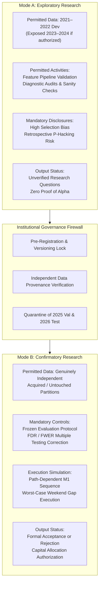

# Phase 35: Research Modes & Governance Framework

**Document Type:** Quantitative Research Methodology & Governance Policy  
**Author:** Senior Quantitative Research Auditor & Financial Data Governance Engineer  
**System:** Treading-Ai (XAUUSD Research-Only)  
**Date:** November 2026  
**Status:** APPROVED & BINDING  

---

## 1. Executive Summary & Purpose

Following the Phase 34 audit finding that no verified independent confirmatory dataset is available in local storage, this document establishes a formal, dual-track research architecture for the Treading-Ai project. 

Historically, quantitative projects suffer from subtle methodological drift: exploratory iterations on a historical dataset are gradually misconstrued as confirmatory evidence of an alpha edge. To permanently eliminate this failure mode, the project formally partitions all research activities into two mutually exclusive operating modes:
1. **Mode A: Exploratory Research** (Hypothesis formulation, feature engineering, diagnostic audits, and historical discovery).
2. **Mode B: Confirmatory Research** (Out-of-sample validation, hypothesis testing, and production authorization).

No strategy, model, or quantitative finding from Exploratory Research may be promoted or cited as verified without passing through an authorized Confirmatory Research phase on genuinely independent data.

---

## 2. Dual Research Mode Specifications

---

### Mode A: Exploratory Research

#### 1. Scope & Permitted Datasets
- **Primary Data:** Permitted strictly to use the 2021–2022 development partition (`XAUUSD_H4_2021/2022.parquet`, `XAUUSD_D1_2021/2022.parquet`, and raw M1 source files).
- **Secondary Data (Conditional):** If explicitly authorized by stakeholders, the 2023–2024 partition may be inspected for diagnostic regime modeling, provided it is prominently labeled as *previously exposed historical data*.

#### 2. Permitted Activities
- Mathematical formula verification and technical indicator engineering.
- Feature pipeline causality testing, timestamp alignment, and lookahead leakage prevention.
- Data completeness audits and empirical distribution modeling.
- Formulation and formal pre-registration of economic swing hypotheses.
- Exploratory signal density and execution mechanics sanity checks (when explicitly authorized).

#### 3. Mandatory Governance Disclosures
Every report, notebook, script, or presentation generated under Mode A must include the following prominent disclaimer:
> **RESEARCH INTEGRITY DISCLOSURE (MODE A):**  
> *"All analyses, metrics, and observations in this document are exploratory and derived from previously exposed historical data (2021–2022). This dataset has been iteratively investigated across multiple prior research cycles. Findings are subject to retrospective selection bias, data snooping, and survivorship distortion. Mode A results CANNOT establish an authentic trading edge, statistical confirmation, or justification for live capital deployment."*

#### 4. Hard Constraints
- Mode A results cannot be used to declare a hypothesis "validated," "profitable," or "ready for production."
- Parameters, indicators, and decision rules discovered or refined in Mode A cannot be tested on the same dataset to claim out-of-sample success.

---

### Mode B: Confirmatory Research

#### 1. Scope & Permitted Datasets
- **Mandatory Data Independence:** Confirmatory research requires a **genuinely independent historical dataset** whose outcomes, regimes, and macro performance have NOT been previously examined, evaluated, or exposed to researchers.
- **Holdout Inviolability:** The 2025 Validation partition (`val.parquet`) and 2026 Test partition (`test.parquet`) remain strictly quarantined. They may only be accessed sequentially as the final tier of Mode B after independent confirmatory evaluation is concluded.

#### 2. Prerequisites for Entering Mode B
Mode B cannot be initiated until four prerequisite gates are formally certified by an independent auditor:
1. **Provenance Certification:** The candidate confirmatory dataset must have fully documented source provenance, verified tick/quote integrity, and unbroken custody.
2. **Pre-Registration Lock:** All hypothesis rules, decision timestamps, target/stop geometries, and cost models must be frozen in a versioned register before the confirmatory dataset is loaded.
3. **Pre-Approved Evaluation Protocol:** The evaluation protocol (including sample size thresholds, FDR/FWER corrections, and falsification rules) must be pre-registered without ambiguity.
4. **Stakeholder Authorization:** Explicit stakeholder approval must be granted to conduct the evaluation.

#### 3. Execution Simulation & Cost Standards
- Must execute path-dependent intra-bar simulation (using underlying M1 data) to resolve intra-candle stop vs target breaches.
- Maximum Favorable Excursion (MFE) cannot substitute for actual trade accounting.
- Must execute worst-case Sunday opening price fills for stop-loss orders breached across weekend market closures.
- Must model asymmetric overnight financing swap rates (negative carry on long positions).

#### 4. Outcomes & Authority
- Confirmatory research produces a binding verdict: **PASS** (Hypothesis Confirmed) or **FAIL** (Hypothesis Permanently Rejected).
- A rejected hypothesis is declared permanently dead and cannot be retrofitted or re-tested on the same confirmatory dataset.

---

## 3. Governance Firewall & Transition Rules

To prevent contamination between research modes, the following firewalls are institutional policy:

| Rule | Policy Directive | Violation Consequence |
| :--- | :--- | :--- |
| **Firewall 1: Data Separation** | Datasets used in Mode A are permanently disqualified from serving as confirmatory testbeds in Mode B. | Invalidation of all confirmatory claims; formal audit failure. |
| **Firewall 2: Parameter Immutability** | No parameter, indicator period, or threshold may be adjusted after viewing Mode B evaluation outcomes. | Instant disqualification of the strategy; permanent rejection. |
| **Firewall 3: Holdout Quarantine** | `val.parquet` (2025) and `test.parquet` (2026) cannot be queried, loaded, or hashed during exploratory research. | Breach of project governance; reset of project validation status. |
| **Firewall 4: Explicit Labeling** | Any strategy performance cited must clearly declare whether it was generated under Mode A or Mode B. | Retraction of research documentation. |

---

## 4. Evidentiary Categorization

### Verified Facts:
- 2021–2022 data has been used across dozens of prior research cycles (Phases 3–15, 22, 25, 33).
- 2023–2024 data was evaluated in Phase 23 (`HYP-21`) and Phase 26 (`HYP-24`).
- No independent confirmatory dataset currently exists in the workspace.

### Assumptions:
- It is assumed that future external data acquisition can provide an uninspected historical period suitable for Mode B confirmatory research.

### Recommendations:
- All immediate project work must remain strictly within Mode A (feature pipeline refinement, infrastructure robustness, defect resolution).
- Mode B must remain locked until an independent dataset is acquired and verified.
