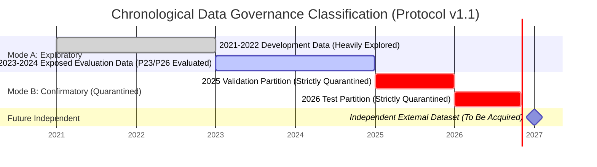

# Phase 36: Multi-Timeframe Swing Evaluation Protocol (v1.1 Amendment)

**Document Type:** Formal Versioned Protocol Amendment  
**Version:** 1.1 (Supersedes v1.0 in `reports/phase33/evaluation_protocol.md`)  
**Target Asset:** Spot Gold (XAUUSD)  
**Execution Context:** Swing Trading (H4 Execution Bars / D1 Macro Regime)  
**Author:** Senior Quantitative Research Engineer & Financial ML Governance Auditor  
**Date:** November 2026  
**Status:** FROZEN & PRE-REGISTERED (Zero backtests run; evaluation remains unauthorized)  

---

## 1. Document Control & Change Log

This document represents an explicit, version-controlled amendment to the evaluation protocol originally established in [`reports/phase33/evaluation_protocol.md`](file:///home/bhoot/project/Treading-Ai/reports/phase33/evaluation_protocol.md). The original protocol is preserved as the v1.0 historical baseline; all changes below constitute v1.1 amendments addressing open governance and specification defects DEF-35-01 through DEF-35-05.

### Amendment Changelog:

| Section Modified | Defect ID | Summary of Amendment | Governance Rationale |
| :--- | :--- | :--- | :--- |
| **Section 2 (Data Splits)** | DEF-35-05 | Formally revokes "untouched confirmatory" label for 2023–2024. Reclassifies 2023–2024 as exposed historical data. | Eliminates false claims of data independence; preserves holdout quarantines. |
| **Section 3 (Sample Size)** | DEF-35-01 | Reconciles $N \ge 60$ gate with low-frequency swing expectations (30–70 trades). Defines minimum operational sample vs statistical power ($1-\beta$). | Prevents guaranteed rejection traps; establishes objective power requirements. |
| **Section 4 & 8 (Costs & Swaps)**| DEF-35-03 | Replaces symmetric swap model with independent Long/Short financing carry, triple-swap rules, and separate friction components. | Reflects real-world negative carry on long spot gold; separates illustrative from calibrated rates. |
| **Section 4 (Gap Risk)** | DEF-35-04 | Mandates Sunday market open execution for stops breached across weekend market closures. | Eliminates unrealistically optimistic stop fills across 49-hour weekend halts. |
| **Section 4 (Completeness)** | DEF-35-02 | Formally classifies the 1,350-minute threshold as an unverified empirical heuristic and mandates multi-cutoff sensitivity testing. | Eliminates unproven claims of exchange holiday schedules; ensures threshold robustness. |
| **Section 6 (Multiple Testing)** | DEF-35-05 | Defines the specific family of hypotheses $\{H1, H2, H3\}$, details Holm-Bonferroni / Benjamini-Hochberg limitations, and mandates bootstrap permutation. | Controls family-wise error rate and false discovery rate under correlated return series. |
| **Section 11 (Deployment Gate)** | Governance | Codifies a 5-stage sequential capital deployment gate. Passing one stage does not authorize the next. | Enforces institutional separation between research approval and live execution. |

---

## 2. Chronological Data Architecture & Mode B Requirements

### 2.1 Formal Data Split Classification (v1.1)
In accordance with [`reports/phase34/data_split_governance_audit.md`](file:///home/bhoot/project/Treading-Ai/reports/phase34/data_split_governance_audit.md), the chronological partitions are strictly classified as follows:



1. **Development Partition (2021–2022):** Mode A Exploratory only. Contaminated by iterative research; cannot validate edge.
2. **Exposed Evaluation Partition (2023–2024):** Mode A Exploratory only. Previously evaluated in Phase 23 (`HYP-21`) and Phase 26 (`HYP-24`). **Under no circumstances may 2023–2024 be cited as an independent confirmatory testbed.**
3. **Protected Validation Partition (2025) & Test Partition (2026):** Quarantined holdouts. Inaccessible until independent confirmatory research is completed.
4. **Mandatory Confirmatory Requirement:** Confirmatory evaluation of Phase 33 hypotheses requires an **independent historical dataset** compliant with [`reports/phase35/data_acquisition_requirements.md`](file:///home/bhoot/project/Treading-Ai/reports/phase35/data_acquisition_requirements.md).

---

## 3. Sample-Size Gate & Statistical Power Protocol

### 3.1 Minimum Operational Sample Count vs. Adequate Statistical Power
A critical defect in v1.0 was the arbitrary uniform gate $N \ge 60$ trades across 2 years, which contradicted the pre-registered frequency ranges of selective swing architectures (`H-Swing-02`: 40–70 trades; `H-Swing-03`: 30–60 trades).

To resolve this defect without arbitrarily lowering scientific standards:
- **Minimum Operational Sample Count ($N_{\text{min}}$):** The absolute minimum number of observations required to compute basic statistical metrics (mean, standard deviation, bootstrap intervals) without severe finite-sample distortion.
- **Adequate Statistical Power ($1 - \beta$):** The probability of correctly rejecting the null hypothesis of zero net expectancy ($\mathcal{H}_0: \mu \le 0$) when an authentic economic edge exists.

### 3.2 Formal Power Formulation
For a swing strategy with expected annualized Sharpe ratio $SR = 0.50$ (corresponding to a trade-level signal-to-noise ratio $\frac{\mu}{\sigma} \approx 0.18$ to $0.20$), the sample size $N$ required to achieve $80\%$ statistical power ($\beta = 0.20$) at a two-sided significance level $\alpha = 0.05$ is given by:

$$N \ge \left( \frac{z_{1 - \alpha/2} + z_{1 - \beta}}{\mu / \sigma} \right)^2 \approx \left( \frac{1.960 + 0.842}{0.20} \right)^2 \approx 196 \text{ trades}$$

If an evaluation partition spans only 2 years and generates only 40 to 60 trades, the statistical power is severely degraded ($1 - \beta \approx 25\%$ to $35\%$). A non-significant result ($p > 0.05$) under 40 trades is ambiguous: it may reflect an unviable strategy, or merely a Type II error (insufficient sample size).

### 3.3 Two-Tier Sample-Size Decision Gate (v1.1)

```
+------------------------------------+--------------------------+-------------------------------------------------------+
| Realized Trade Count (2-Year Eval) | Decision Classification  | Permitted Action & Next Steps                         |
+------------------------------------+--------------------------+-------------------------------------------------------+
| N < 35 trades                      | INSTANT REJECTION        | Strategy lacks operational viability; rejected.       |
+------------------------------------+--------------------------+-------------------------------------------------------+
| 35 <= N < 80 trades                | INCONCLUSIVE             | Cannot reject null hypothesis with power; requires an |
|                                    | (UNDERPOWERED)           | extended multi-year evaluation partition (3-5 years). |
+------------------------------------+--------------------------+-------------------------------------------------------+
| N >= 80 trades                     | FULL STATISTICAL GATE    | Adequate sample for evaluation; subject to formal     |
|                                    | (POWERED)                | Sharpe, Calmar, and FDR/FWER rejection criteria.      |
+------------------------------------+--------------------------+-------------------------------------------------------+
```

**Key Governance Directive:** Under no circumstances may sample-size gates be relaxed *post hoc* after viewing strategy outcomes.

---

## 4. Execution Costs, Financing & Weekend Gap Risk

### 4.1 Independent Cost Component Decomposition
All performance simulations must explicitly decompose transaction friction into four independent accounting terms:
$$\text{Total Trade Friction} = \text{Spread} + \text{Commission} + \text{Slippage} + \text{Financing Carry}$$

1. **Bid-Ask Spread:** Modeled dynamically from historical bid/ask quotes where available. In synthetic testing:
   - Low Spread: $1.5$ pips ($\$0.15/\text{oz}$).
   - Baseline Spread: $2.5$ pips ($\$0.25/\text{oz}$).
   - Stressed Spread: $4.0$ pips ($\$0.40/\text{oz}$).
2. **Broker Execution Commission:** Fixed round-turn charge of $\$0.05/\text{oz}$.
3. **Execution Slippage:** Modeled as $1.0$ pip ($\$0.10/\text{oz}$) baseline, stressed to $2.0$ pips ($\$0.20/\text{oz}$) for breakout momentum entries.

### 4.2 Asymmetric Overnight Financing (Swap) Model
Retail spot gold brokers do NOT charge symmetric financing rates. Long positions incur a borrowing cost based on US SOFR plus a broker retail spread, while short positions receive gold lending yields minus broker markup (often resulting in negative carry on both sides).

All future evaluations must test the following **Asymmetric Financing Matrix**:

| Scenario Tier | Long Overnight Carry | Short Overnight Carry | Triple-Swap Scheduling | Governance Label |
| :--- | :---: | :---: | :---: | :--- |
| **Scenario 1 (Optimistic)** | $-\$0.15 / \text{oz} / \text{day}$ | $-\$0.02 / \text{oz} / \text{day}$ | Wednesday 3-day rollover (3x) | Unverified Research Assumption |
| **Scenario 2 (Baseline)** | $-\$0.22 / \text{oz} / \text{day}$ | $-\$0.05 / \text{oz} / \text{day}$ | Wednesday 3-day rollover (3x) | Unverified Research Assumption |
| **Scenario 3 (Stressed)** | $-\$0.35 / \text{oz} / \text{day}$ | $-\$0.12 / \text{oz} / \text{day}$ | Wednesday 3-day rollover (3x) | Unverified Research Assumption |

*Mandatory Disclaimer:* These swap scenarios are unverified research models. Prior to live deployment, swap rates must be validated against actual institutional broker rate sheets.

### 4.3 Weekend Market Closure & Opening Gap Execution Policy
Spot gold trading halts every Friday at 17:00 New York Time and reopens Sunday at 18:00 New York Time (a 49-hour gap). Geopolitical and macro news over weekends regularly produces significant opening price gaps.

**Mandatory Gap Execution Rules:**
1. **Valuation Across Closure:** Active positions held over the weekend are marked-to-market at the Friday 17:00 NY closing quote.
2. **Stop Loss Gap Execution:** If the Sunday market open price gaps beyond an active stop-loss level:
   $$\text{Execution Fill Price} = \text{Sunday Market Open Price}$$
   Under no circumstances may a backtest assume execution occurred at the pre-gap stop price.
3. **Missing Opening Quotes:** If the data feed exhibits a dropout at the Sunday reopen, position valuation is marked as uncertain. The fill is executed at the first available tick with an additional $2.0$ pip uncertainty penalty.

---

## 5. Session Completeness & Sensitivity Testing

### 5.1 Reclassification of the 1,350-Minute Threshold
The existing pipeline condition:
```python
merged["d1_regular_session"] = merged["d1_bar_count"] >= 1350
```
is formally recognized as an **UNVERIFIED EMPIRICAL HEURISTIC** (Phase 34 audit finding). It was selected to accommodate quiet Asian minutes without exchange schedule verification.

### 5.2 Mandatory Completeness Sensitivity Matrix
To ensure strategy robustness does not depend on the arbitrary 1,350 cutoff, all future evaluations must execute a three-way sensitivity analysis across alternative completeness thresholds:

```
+--------------------------+---------------------+-------------------------------------------------------+
| Sensitivity Tier         | Bar Cutoff (D1)     | Physical Market Rationale                             |
+--------------------------+---------------------+-------------------------------------------------------+
| Tier A: Strict Standard  | N == 1380 bars      | 100% complete constituent minutes only; rejects any   |
|                          |                     | session with even a single quiet minute.              |
+--------------------------+---------------------+-------------------------------------------------------+
| Tier B: Heuristic Base   | N >= 1350 bars      | Permits up to 30 quiet/unquoted minutes in a 23h day; |
| (Default)                |                     | filters major holiday early closures.                 |
+--------------------------+---------------------+-------------------------------------------------------+
| Tier C: Permissive       | N >= 1320 bars      | Permits up to 60 quiet minutes (e.g. Easter rollover  |
|                          |                     | and extended low-volume Asian sessions).              |
+--------------------------+---------------------+-------------------------------------------------------+
```

**Pass Criterion:** Strategy net expectancy must remain positive ($E_{\text{net}} > 0$) across all three tiers. A strategy that fails under Tier A or Tier C is flagged for fragility.

---

## 6. Multiple-Testing Correction & Hypothesis Governance

### 6.1 Defined Hypothesis Family
The multiple-testing family $\mathcal{F}$ is strictly defined as the three pre-registered swing hypotheses:
$$\mathcal{F} = \{ \text{H-Swing-01}, \text{H-Swing-02}, \text{H-Swing-03} \}$$

### 6.2 Multiple-Comparison Procedures
1. **Family-Wise Error Rate (FWER) — Holm-Bonferroni Step-Down:**
   - Controls the probability of making even one false discovery across $\mathcal{F}$.
   - Rank unadjusted p-values: $p_{(1)} \le p_{(2)} \le p_{(3)}$.
   - Step 1: Reject $\mathcal{H}_{(1)}$ if $p_{(1)} \le \frac{0.05}{3} \approx 0.0167$.
   - Step 2: If rejected, test $\mathcal{H}_{(2)}$ at $\frac{0.05}{2} = 0.0250$.
   - Step 3: If rejected, test $\mathcal{H}_{(3)}$ at $\frac{0.05}{1} = 0.0500$.
2. **False Discovery Rate (FDR) — Benjamini-Hochberg (BH):**
   - Controls the expected proportion of false discoveries among rejected hypotheses.
   - Evaluated at $\alpha = 0.05$.
3. **Limitation & Bootstrap Requirement:**
   - Parametric Bonferroni and BH assume independent or positively dependent test statistics. Because gold swing strategies trade the same underlying price series, their returns exhibit cross-sectional correlation.
   - **Mandatory Control:** Parametric p-values must be corroborated by a **Moving-Block Bootstrap Permutation Test** (minimum 2,000 resamples with 10-day block length) preserving serial and cross-sectional dependence.

---

## 7. Staged Capital Deployment Gate

Passing a quantitative backtest on historical data does not justify live capital risk. Live deployment is partitioned into five distinct, sequential governance stages:

```
[Stage 1: Research & Data-Integrity Approval] 
       │ (Phase 33–36 Complete)
       ▼
[Stage 2: Independent Out-of-Sample Evaluation] 
       │ (Mode B Independent Testbed Required)
       ▼
[Stage 3: Broker-Specific Execution & Cost Validation] 
       │ (Real L2 Tick Feeds & Verified Swap Sheets)
       ▼
[Stage 4: Forward Paper-Trading Incubation] 
       │ (>= 90 Days Live Market Feed, >= 25 Realized Trades)
       ▼
[Stage 5: Independent Risk Review & Capital Authorization] 
       │ (Signed Chief Risk Officer Sign-Off)
       ▼
[Live Execution]
```

**Non-Automatic Progression Rule:** Passing Stage $k$ grants zero automatic authority to proceed to Stage $k+1$. Each stage transition requires an independent audit report and signed stakeholder authorization.

---

## 8. Summary of Rejection & Falsification Criteria (v1.1)

A hypothesis is **PERMANENTLY REJECTED** if it triggers any of the following conditions on an independent confirmatory partition:

1. **Negative Expectancy:** Net Expectancy $\le \$0.00/\text{oz}$ under Baseline costs.
2. **Sub-Threshold Sharpe:** Annualized Net Sharpe Ratio $< 0.50$ after full friction.
3. **Sub-Threshold Profit Factor:** Net Profit Factor $< 1.25$ after full friction.
4. **Excessive Drawdown:** Maximum drawdown exceeds $15.0\%$ under $1.0\%$ fixed risk sizing.
5. **Directional Collapse:** Long or Short sub-cohort produces a Net Profit Factor $< 1.0$.
6. **Multiple Testing Failure:** Fails Holm-Bonferroni FWER or Benjamini-Hochberg FDR control at $\alpha = 0.05$.
7. **Random Permutation Failure:** Permutation test $p$-value $\ge 0.05$ against 2,000 synthetic simulations.
8. **Operational Sample Failure:** Realized trades $N < 35$ across evaluation partition.

---

## 9. Pre-Registration Declaration & Attestation

We hereby attest that:
1. Protocol v1.1 was finalized **prior to conducting any backtest or outcome analysis**.
2. No strategy rules or indicator definitions were modified.
3. No strategy evaluation is authorized until an independent confirmatory dataset is acquired.
